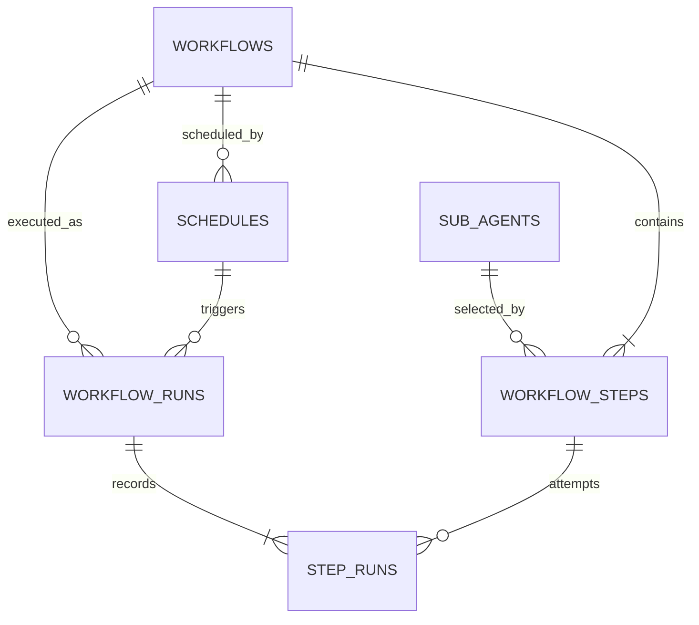

# Switch — Service Plan

## Goal

Build a modular job-switch automation platform where workflows invoke detachable sub-agent services through a common HTTP API. A sub-agent may be a browser agent, research agent, document agent, or any future implementation.

## 1. Scheduled Workflow Service — implemented foundation

**Project:** `switch`

### Responsibilities

- Discover detachable sub-agent services by ID, description, enabled state, and `/invoke` URL.
- Define a workflow as an ordered stack of sub-agents with a fixed JSON payload per step.
- Store schedules independently so one workflow can have multiple exact times and time ranges.
- Support daily, monthly, and yearly recurrence.
- Execute eligible workflows manually, from Windows Task Scheduler callbacks, and from startup/periodic reconciliation.
- Catch up exact-time schedules after downtime when enabled and still inside their configured delay window.
- Execute range schedules when the server becomes live inside the selected start/end range.
- Persist workflow runs and every step attempt, response, error, and timestamp.

### Low-level data model



- `sub_agents`: ID, name, description, invoke URL, enabled, created/modified timestamps.
- `workflows`: ID, name, description, total sub-agents, enabled, created/modified timestamps.
- `workflow_steps`: workflow ID, sub-agent ID, stack position, and predetermined JSON payload.
- `schedules`: workflow ID, type (`time` or `range`), recurrence, exact time or range start/end, monthly/yearly date fields, missed-run option, delay/grace, enabled state, and Windows task registration state.
- `workflow_runs`: the track table; workflow/schedule IDs, occurrence key, status, attempt count, scheduled/start/finish timestamps, and error.
- `step_runs`: each sub-agent invocation attempt, response, error, and timestamps.

The unique `(schedule_id, occurrence_key)` claim makes Windows callbacks and server reconciliation idempotent. A failed occurrence can be retried with an incremented attempt count while successful/running occurrences are not duplicated.

### Schedule semantics

- **Time:** stores only `time_of_day`.
- **Range:** stores only `range_start` and `range_end`; the first eligible check inside the range claims that occurrence.
- **Daily:** no date fields.
- **Monthly:** requires `day_of_month`.
- **Yearly:** requires `month` and `day_of_month`.
- All times are minute-precision in the server/Windows local timezone; ranges currently stay within one calendar day.
- `run_if_missed=false` allows only a short on-time tolerance.
- `run_if_missed=true` allows a time occurrence until `misfire_grace_minutes` expires.
- Multiple times/ranges are represented by multiple schedule rows for the same workflow.

### Trigger and recovery flow

1. Creating or modifying an enabled schedule registers one `schtasks.exe` task at its exact time or range start.
2. The Windows task calls `POST /api/scheduled/run/{workflow_id}?schedule_id={schedule_id}`.
3. The API recalculates whether that schedule is currently eligible and claims its occurrence.
4. Workflow steps call each registered sub-agent `/invoke` endpoint sequentially with their fixed payloads.
5. The service marks every step and the workflow run succeeded or failed.
6. On server startup, and every polling interval, the service scans schedule rows for eligible uncompleted occurrences.
7. This startup scan handles a missed exact time within its delay window and a range whose current time is between start/end.

### Scheduled API

- `POST/GET/PATCH /api/scheduled/sub-agents`
- `POST/GET /api/scheduled/workflows`
- `POST/GET/PATCH/DELETE /api/scheduled/schedules`
- `POST /api/scheduled/run/{workflow_id}`
- `GET /api/scheduled/runs`
- `GET /api/scheduled/runs/{run_id}/steps`
- `POST /api/scheduled/reconcile`

### Sub-agent contract

Every detachable sub-agent service exposes `POST /invoke`, accepts its own JSON payload, and returns a JSON result. The scheduler only knows the registered URL and fixed step payload, so agent implementations remain replaceable.

### Implemented structure

```text
switch/
├── app/
│   ├── routes/scheduled.py
│   ├── app.py
│   ├── database.py
│   ├── execution.py
│   ├── models.py
│   ├── schedule_engine.py
│   ├── scheduler.py
│   ├── schemas.py
│   └── windows_scheduler.py
├── prisma/
│   ├── migrations/
│   └── schema.prisma
├── tests/
├── main.py
├── pyproject.toml
└── README.md
```

## 2. Sub-agent Services

Independent services implementing the common `/invoke` contract. Initial candidates:

- Browser agent — website navigation, form interaction, and extraction.
- Job discovery agent — searches selected job sources.
- Job matching agent — scores roles against a profile.
- Resume tailoring agent — prepares role-specific resume content.
- Application agent — performs approved application steps.
- Interview preparation agent — creates company and role preparation packs.
- Notification agent — sends run results and approval requests.

Each service owns its task-specific logic and can be deployed, replaced, or scaled independently.

### Browser Agent Service — implemented scaffold

**Project:** `browseragent`

- Exposes `POST /invoke` with a task and bounded maximum step count.
- Creates a fresh `browser-use` `Agent` for each request and awaits its execution.
- Runs the browser locally and uses either native `ChatOpenAI` or `ChatOpenRouter` LLM integration.
- Keeps `OPENAI_API_KEY` and `OPENROUTER_API_KEY` in the service environment; workflows select a provider/model without receiving credentials.
- Supports service-wide provider/model defaults and per-workflow invocation overrides.
- Returns completion status, final result, step count, execution errors, provider, and model for observability.
- Closes the agent after every request, including failed runs.
- Exposes `GET /health` for scheduler availability checks.
- Runs independently on port `8001`, so the scheduler registers it by URL and invokes it without browser-specific coupling.

```text
browseragent/
├── app/
│   ├── __init__.py
│   ├── app.py
│   └── llm.py
├── tests/
│   ├── test_app.py
│   └── test_llm.py
├── .env.example
├── main.py
├── pyproject.toml
└── README.md
```

## 3. Workflow Execution Service

Start inside the Scheduled Workflow Service, then extract if load requires it.

- Validate workflow graphs and payload templates.
- Resolve step dependencies and output references.
- Invoke independent steps concurrently.
- Persist execution state so runs are observable and recoverable.
- Support pause-for-approval steps for sensitive actions.

## 4. Persistence and Queue

### Implemented persistence foundation

- PostgreSQL stores sub-agents, workflows, ordered steps, schedules, workflow runs, and step runs.
- `switch/prisma/schema.prisma` is the model source of truth.
- Prisma migrations are committed under `switch/prisma/migrations/`.
- FastAPI uses the generated asynchronous Prisma Python client; SQLAlchemy models are not duplicated.
- Repository-level `compose.yaml` provides PostgreSQL on the `switch-backend` network.
- The `switch-postgres-data` named volume preserves database data across container recreation.

### Planned infrastructure

- Redis-backed queue for asynchronous execution, retries, and multi-process concurrency control.
- Object storage for larger artifacts such as generated resumes and reports.

## 5. Observability and Usage API

Provides a unified read model for:

- Service and sub-agent health.
- Active, completed, failed, and cancelled runs.
- Per-workflow and per-agent latency, success rate, and retry count.
- Token, request, browser-time, and estimated cost usage reported by agents.
- Structured logs and execution traces linked by run and step IDs.

Use OpenTelemetry-compatible trace and metric fields from the start.

## 6. Web UI — implementation plan

**Project:** `dashboard`

Build an original operations dashboard inspired by the reference's airy layout, rounded white workspace, slim icon navigation, dark typography, blue focus actions, and restrained pastel gradients. Use the reference as visual direction only rather than reproducing its composition or assets.

### Product goals

- Make current system health and upcoming work understandable in under ten seconds.
- Let a user register agents, assemble a workflow stack, attach several schedules, and run it without leaving the UI.
- Make every workflow occurrence traceable down to its sub-agent requests, responses, retries, and errors.
- Keep advanced JSON payload editing available without making the basic flow feel technical.

### Proposed frontend stack

- Next.js with TypeScript and the App Router.
- Tailwind CSS with CSS variables for design tokens.
- shadcn/ui primitives for accessible dialogs, forms, menus, tabs, and tables.
- TanStack Query for API state, caching, polling, retries, and invalidation.
- React Hook Form and Zod for client-side forms matching FastAPI schemas.
- dnd-kit for sortable workflow stacks.
- Recharts for usage and execution charts.
- Lucide icons; no copied icons or imagery from the reference.

### Information architecture

Use a compact left navigation rail on desktop and a bottom navigation sheet on mobile:

1. **Overview** — operational summary and next actions.
2. **Workflows** — workflow catalog and stack builder.
3. **Schedules** — calendar/list of exact-time and range schedules.
4. **Sub-agents** — service discovery, health, and invoke configuration.
5. **Runs** — live and historical workflow execution tracking.
6. **Usage** — requests, success rate, duration, and future token/cost data.
7. **Settings** — API address, database/infrastructure state, timezone, and appearance.

A global command/search field should find workflows, agents, schedules, and run IDs. The top bar also contains environment health, theme, and a primary **Create workflow** action.

### Visual system

- **Canvas:** warm off-white application background with a subtle blue/lavender/peach ambient gradient only around major summary areas.
- **Workspace:** white surfaces, thin neutral borders, soft shadows, and 20–24 px radii for primary cards.
- **Typography:** high-contrast ink headings, muted gray metadata, generous line height, and tabular numerals for times and metrics.
- **Accent:** electric/cobalt blue for primary actions, selection, active navigation, and progress; near-black for strong secondary actions.
- **Status colors:** emerald success, amber waiting/retry, red failure, blue running, gray disabled.
- **Density:** spacious summary screens; compact but readable tables for operational data.
- **Motion:** 150–220 ms transitions, subtle card/row entrance, animated run progress, and full reduced-motion support.
- Support light and dark themes from the token layer, with light theme delivered first.

### Screen 1 — Overview

- Greeting and concise system-status statement.
- Summary cards: active workflows, enabled schedules, healthy agents, success rate, failed runs.
- **Next scheduled runs** timeline showing exact time/range, recurrence, and countdown.
- **Live activity** feed for running workflows and current sub-agent step.
- Seven-day execution chart split by succeeded/failed.
- Agent health strip with latency and last-seen state.
- Quick actions: create workflow, register sub-agent, run workflow, reconcile schedules.
- Empty state that guides first-time setup in the correct order.

### Screen 2 — Workflows

#### Workflow catalog

- Search, enabled/disabled filter, agent filter, and last-run status filter.
- Card/list toggle showing name, description, number of steps, number of schedules, next run, and recent success rate.
- Row actions: open, run now, duplicate, enable/disable, and delete with confirmation.

#### Workflow builder

Use a three-panel workspace:

- **Agent catalog:** searchable registered agents with health and descriptions.
- **Workflow stack:** sortable numbered steps connected vertically; adding the same agent more than once is allowed.
- **Inspector:** fixed JSON payload editor for the selected step, validation state, agent endpoint, and test-invoke action.

The header contains workflow name/description, unsaved state, save, and run preview. A summary below the stack shows expected call order and attached schedules.

### Screen 3 — Schedules

- Toggle between list, weekly calendar, and timeline views.
- Filter by workflow, type, recurrence, enabled state, and registration status.
- Schedule cards display workflow, `time` or `range`, local time, recurrence, missed-run behavior, next occurrence, and Windows task state.
- One workflow can show multiple schedule chips grouped together.

#### Schedule editor drawer

- Workflow selector.
- Type segmented control: **Exact time** or **Time range**.
- Time picker, or start/end time pickers for a range.
- Recurrence segmented control: daily, monthly, yearly.
- Conditional day-of-month and month fields.
- **Run when server returns** checkbox.
- Grace/delay field shown when missed-run recovery is enabled.
- Human-readable preview such as “Every month on day 15, between 9:00 PM and 11:00 PM.”
- Registration result showing Windows task name or actionable error.

### Screen 4 — Sub-agents

- Service cards with name, description, `/invoke` URL, enabled state, health, latency, and last invocation.
- Add/edit drawer with URL validation and connection test.
- Interactive trial console for sending ad-hoc JSON payloads and inspecting status, latency, errors, and raw agent responses.
- Agent detail page with workflows using it, recent calls, success rate, and response-time chart.
- Payload schema support is a later enhancement; initial payload editing remains JSON.

### Screen 5 — Runs

- Live-first table with status, workflow, trigger, scheduled time, actual start, duration, attempts, and current step.
- Filters for status, workflow, agent, trigger type, and date range.
- Manual refresh plus low-frequency polling; increase polling while a run is active.

#### Run detail

- Header with status, trigger, schedule occurrence, timing, retry action, and copyable run ID.
- Vertical step timeline with agent, payload, response, start/finish time, attempt, and error.
- Raw JSON viewer with copy/download controls.
- Distinguish schedule failures, sub-agent HTTP failures, and configuration failures.

### Screen 6 — Usage and observability

- Time-range picker and workflow/agent filters.
- KPI cards for invocations, success rate, p50/p95 duration, retries, and estimated cost.
- Execution trend, latency trend, and agent distribution charts.
- Failure-reason breakdown and slowest workflow table.
- Clearly label token/cost panels as unavailable until agents report usage metadata.

### Shared components

- Application shell, navigation rail, top command bar, and responsive mobile navigation.
- Status badge, metric card, health dot, empty state, error state, and skeleton loaders.
- Workflow stack step, payload editor, schedule summary chip, recurrence formatter, and time-range picker.
- Run timeline, JSON inspector, confirmation dialog, toast system, and API error boundary.
- Reuse one typed API client and one formatting layer for dates, durations, statuses, and errors.

### API mapping

Existing scheduler APIs cover the MVP:

- Sub-agent list/create/edit.
- Workflow list/create/detail.
- Schedule list/create/edit/delete.
- Manual workflow run and schedule reconciliation.
- Run list and step details.

Backend additions needed for the complete UI:

- Workflow update, enable/disable, duplicate, and delete endpoints.
- Agent health-check endpoint and persisted health/latency state.
- Aggregated overview and usage endpoints to avoid expensive client-side joins.
- Pagination and server-side filtering for runs.
- Next-occurrence value in schedule responses.
- Cancellation/retry endpoints and live updates through SSE or WebSocket.
- Authentication before exposing the dashboard outside localhost.

### Responsive and accessibility requirements

- Desktop optimized at 1280 px and above; usable tablet layout at 768 px; focused single-column mobile flows.
- Workflow builder panels collapse into catalog/stack/inspector tabs on smaller screens.
- Keyboard-operable drag alternatives and move-up/move-down actions.
- WCAG AA color contrast, visible focus, labeled icon buttons, semantic tables, and screen-reader status announcements.
- Never rely on color alone for run or health state.

### UI delivery phases

1. Set up `dashboard`, tokens, application shell, navigation, typed API client, and reusable loading/error states.
2. Build Overview using existing list/run APIs with temporary client-side aggregation.
3. Build Sub-agents catalog and create/edit forms.
4. Build Workflow catalog and sortable stack/payload builder.
5. Build Schedule list and exact-time/range editor.
6. Build Runs table and detailed step timeline.
7. Add backend aggregate/health APIs, then Usage and richer Overview charts.
8. Add dark theme, responsive polish, accessibility audit, visual regression tests, and end-to-end tests.

### MVP acceptance criteria

- Register and edit a sub-agent from the UI.
- Create a multi-step workflow with fixed payloads in a clear stack.
- Add several exact-time/range schedules to that workflow and edit/delete them.
- Run a workflow manually and see ordered step results.
- Identify active, successful, failed, and missed/retried work from Overview and Runs.
- Handle API downtime, validation errors, empty data, and narrow screens without broken layouts.

## Delivery Phases

1. **Done:** Scaffold the `switch` FastAPI service and scheduled router.
2. **Done:** Add sub-agent discovery and the `/invoke` client contract.
3. **Done:** Add ordered workflow stacks with predetermined payloads and run tracking.
4. **Done:** Add separate schedule CRUD for multiple time/range entries per workflow.
5. **Done:** Add Windows Task Scheduler callbacks, periodic checks, and startup catch-up.
6. **Done:** Move persistence models and migrations to Prisma with Compose-managed PostgreSQL.
7. Add durable distributed queue, configurable retries, cancellation, and multi-process claims.
8. Add output mapping between steps and optional dependency-graph/concurrent execution.
9. Add observability/usage API and OpenTelemetry instrumentation.
10. **Done (MVP):** Build the responsive workflow and operations UI with agents, workflow stack builder, schedules, runs, usage, and settings screens.
11. Add backend workflow mutation/health/aggregate APIs, then connect richer dashboard controls and telemetry.
12. Add authentication, secrets management, approvals, and deployment configuration.
