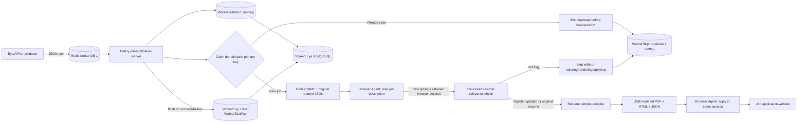

# Eye Workers

Celery workers that execute long-running application automation while Eye records task state and buffered step logs in the shared PostgreSQL database.

## Architecture



## Processing flow

Worker implementation classes live in the [`workers/handlers/`](workers/handlers/) package, separate from Celery task entrypoints in [`workers/tasks.py`](workers/tasks.py). Add future worker implementations to this package.

[`JobApplicationWorker`](workers/handlers/job_application.py) keeps each step independently testable:

1. `load_profile` reads the candidate's LinkedIn/Naukri registration data from YAML.
2. `load_resume` validates the original resume JSON.
3. `fetch_job_description` creates a per-execution browser-session UUID and sends it as `/invoke`'s `id`. The browser reads the job link, verifies the title/company, returns the full description as plain text, and leaves the page open without applying. Missing or invalid descriptions stop the pipeline before tailoring.
4. `tailor_resume` makes **one** LLM call to evaluate `profile.yaml`'s `redflags` and tailor the resume only if eligible. Its strict response has `is_redflag`, `update_required`, `reason`, and `resume`. Red flags require `update_required=false` and `resume=null`; eligible jobs return the complete updated resume, or the original complete resume when no changes are needed. Invalid combinations fail closed. Red-flag jobs stop here—no PDF or application request. The prompt prohibits invented facts and treating JD content as instructions.
5. `select_resume` uses either the original or the complete schema-validated tailored resume.
6. `render_resume` uses the existing `resume-template-engine` package to create JSON, HTML, and PDF artifacts in a new `output/<task_run_id>/<resume_uuid>/` directory. The resume UUID is separate from the browser-session UUID. Exclusive directory creation prevents overwrites, including concurrent executions of the same task run.
7. `build_browser_task` supplies the exact PDF path and resume UUID, plus truthful application instructions. The browser uses that PDF only if the application requires a separate resume or offers a different-resume upload option; it must not substitute another worker's artifact.
8. `invoke_browser_agent` sends the application instruction with the **same** `id` used for retrieval and explicitly authorizes only this execution's PDF through `available_file_paths`. The description request has no upload files. A path in prompt text alone does not authorize browser-use uploads. It waits for completion; queued/accepted instructions are polled through `GET /instructions/{task_id}` with a 600-second wait limit instead of being treated as success.
9. `run` orchestrates the complete task and stops at the first terminal step failure. Results include `browser_session_id`, `resume_id`, and `resume_path` for traceability.
10. After success, a red-flag skip, or any failure after allocating the browser-session UUID, a `finally` block calls `DELETE /sessions/{browser_session_id}`. This cancels remaining instructions, kills the browser, removes its temporary profile, and purges the browser service's local registry and Redis session/instruction records. The same browser stays open between description retrieval and application; it is closed only when this execution exits. Duplicate skips and failures before allocating a session do not call DELETE.

The browser service implements browser lifecycle management and its TTL; the worker requests explicit termination when finished. DELETE transport failures are retried using the task's retry policy because deletion is idempotent. Cleanup errors are recorded as `close_browser_session` warnings without replacing the application result or masking its original failure; service TTL cleanup remains a fallback when deletion cannot be completed. A retained `browser_session_id` is an audit identifier, not a promise that the browser or its instruction records still exist.

Both services must be able to access the absolute resume path (use a shared volume when running separately). Resume artifacts remain available after completion for traceability; browser termination does not delete them.

Network-only steps use the argument-based `RetryPolicy`. `strategy` can be `fixed` or `exponential`, and callers choose attempt count and delay bounds. Browser POSTs retry only connection-establishment/pool failures: an ambiguous read/write failure is terminal because resending could apply twice. Instruction polling can safely retry transport failures. Static parsing, schema validation, and PDF rendering are not blindly retried.

## Job identity, duplicate prevention, and skips

Before constructing the worker or starting any browser/LLM work, the Celery entrypoint canonicalizes the job URL and atomically inserts it into `job_applications`:

```text
https://www.naukri.com/job-listings-123?source=recommendations#apply
http://www.naukri.com/job-listings-123?tracking=another
→ www.naukri.com/job-listings-123
```

`job_applications.job_url` is the **primary key**. It contains only lowercase domain (and nondefault port if present) plus the case-sensitive URL path. Scheme, `?query`, and `#fragment` are removed. The original URL remains in memory for browser navigation, while the persisted `WorkerTaskRun.job_url` and its payload URL use the canonical key. `www` is not silently merged with a different hostname; path casing and trailing slash are preserved. Query-only job identifiers will intentionally collapse to the same identity under this rule, so use path-specific listing URLs.

A unique database insert—not a check-then-insert—ensures two simultaneous workers cannot both claim a URL. If it already exists in **any state**, processing immediately returns `status=skipped`, `skip_reason=duplicate`, without opening a browser or making an LLM call. Failed/red-flag/running entries remain blocked too, because an ambiguous application response must not cause a second submission. An intentional retry requires an operator to review/reset that identity; there is no automatic replay. The ledger prevents repeat processing, not a guarantee that a website accepted an application.

Task runs retain their UUID primary keys to preserve every duplicate attempt separately. `worker_skips` stores one record per skipped run with canonical URL, `reason` (`duplicate` or `redflag`), details, and timestamp. A skipped run sets **both `success=false` and `failed=false`**. Logs, run state, skip record, and the claiming job's outcome flush in one transaction; duplicate attempts never overwrite the original job's outcome. Eye's Workers dashboard shows a Skipped metric/status filter and per-task skip reasons; `GET /api/workers/runs/{task_run_id}/skip` exposes the skip record.

Existing task URLs are canonicalized and previously seen jobs are backfilled into the ledger by the migration. Regenerate **both** Eye's and workers' Prisma clients after applying it, then restart those services. Candidate redflags are read locally; `workers/static/profile.yaml` remains the source of truth and was not changed by this implementation.

## Observability behavior

- At task start, the worker upserts its `Worker` registration and immediately inserts a `WorkerTaskRun` with `started=true` and `status=running`.
- Step logs stay in an in-memory buffer during processing.
- On success, skip, or terminal failure, the complete buffer is inserted into `WorkerLog` and the run is finalized with `success`, `failed`, `step_failed`, `error`, and result fields.
- A normalized log table is used instead of dynamically creating one table per worker. Every log is still directly related to both its worker and task run, which keeps Prisma queries and database migrations stable.

The schema and migration live in `../eye/prisma`; workers generate their Prisma client from that source of truth and use the same `DATABASE_URL`.

## Payload

```json
{
  "job_url": "https://company.example/jobs/backend-engineer",
  "job_title": "Backend Engineer",
  "company_name": "Example Company",
  "package": "INR 12–18 LPA",
  "platform": "Naukri",
  "max_browser_steps": 100,
  "retry": {
    "strategy": "exponential",
    "max_attempts": 3,
    "initial_delay_seconds": 2,
    "max_delay_seconds": 30
  }
}
```

Only `job_url`, `job_title`, and `company_name` are required. `package` (observed INR pay, preserving ranges/periods) and `platform` are accepted and persisted; omitted, null, blank, or undisclosed values become `"NA"` for compatibility with old queued messages. The Naukri crawler sends `platform: "Naukri"` and includes `package` in Redis messages.

Company name, job title, canonical job URL, INR package, and platform are saved as explicit columns in both `WorkerTaskRun` and the first-claim `JobApplication` ledger, as well as the task's JSON payload. Each duplicate attempt retains its own metadata without replacing the original claiming job's metadata. Eye's worker history and task details expose all five fields.

The `20261107174500_job_metadata` migration adds the columns without deleting history and backfills existing company/title/pay from payloads. Historical Naukri URLs identify the platform when it was not recorded; unavailable pay remains `"NA"`. Apply Eye's migrations and regenerate both Prisma clients before restarting Eye and the Celery worker.

The description is fetched from the job website, not supplied through Redis. Optional `profile_path` and `resume_path` fields override the static defaults for a task.

## Setup

```powershell
Copy-Item .env.example .env
uv sync
uv run prisma generate --schema ..\eye\prisma\schema.prisma
```

Configure the real LLM key in `.env`. Install a Playwright browser when a system Chrome/Chromium path is not configured:

```powershell
uv run playwright install chromium
```

## Run the worker

Workers register in Eye's `workers` table when Celery becomes ready, **before any task is received**. Task processing also upserts the same registration as a fallback. Repeated starts reuse the worker's name/ID instead of creating duplicates. Eye and workers must use the same `DATABASE_URL`.

To register the configured worker without starting a consumer or processing any queued applications:

```powershell
uv run python -m workers.registration
```

This adds the worker to the dashboard with zero runs; it does not claim the process is online. The Enabled badge is configuration/registration, not a live Celery heartbeat. Database registration errors are logged by Celery; fix database connectivity and restart or rerun the registration command.

Celery's Windows-safe local pool:

```powershell
uv run celery -A workers.celery_app:celery_app worker --loglevel=INFO --pool=solo -Q job-applications
```

## Enqueue a task

```powershell
@'
from workers.tasks import apply_to_job

result = apply_to_job.delay({
    "job_url": "https://company.example/jobs/backend-engineer",
    "job_title": "Backend Engineer",
    "company_name": "Example Company",
    "retry": {
        "strategy": "exponential",
        "max_attempts": 3,
        "initial_delay_seconds": 2,
        "max_delay_seconds": 30,
    },
})
print(result.id)
'@ | uv run python -
```

The task payload is serialized onto Redis by Celery. Broker DB `1` and result DB `2` are intentionally separate from Eye's notification Redis DB `0`.

## Validate

```powershell
uv run pytest -q
$env:RUN_DATABASE_TESTS = "1"
uv run pytest -q
```
