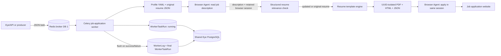

# Eye Workers

Celery workers that execute long-running application automation while Eye records task state and buffered step logs in the shared PostgreSQL database.

## Architecture



## Processing flow

Worker implementation classes live in the [`workers/handlers/`](workers/handlers/) package, separate from Celery task entrypoints in [`workers/tasks.py`](workers/tasks.py). Add future worker implementations to this package.

[`JobApplicationWorker`](workers/handlers/job_application.py) keeps each step independently testable:

1. `load_profile` reads the candidate's LinkedIn/Naukri registration data from YAML.
2. `load_resume` validates the original resume JSON.
3. `fetch_job_description` creates a per-execution browser-session UUID and sends it as `/invoke`'s `id`. The browser reads the job link, verifies the title/company, returns the full description as plain text, and leaves the page open without applying. Missing or invalid descriptions stop the pipeline before tailoring.
4. `tailor_resume` asks the configured LLM for a strict `ResumeTailoringResult` JSON schema using the retrieved description. The prompt prohibits invented facts.
5. `select_resume` uses either the original or the complete schema-validated tailored resume.
6. `render_resume` uses the existing `resume-template-engine` package to create JSON, HTML, and PDF artifacts in a new `output/<task_run_id>/<resume_uuid>/` directory. The resume UUID is separate from the browser-session UUID. Exclusive directory creation prevents overwrites, including concurrent executions of the same task run.
7. `build_browser_task` supplies the exact PDF path and resume UUID, plus truthful application instructions. The browser uses that PDF only if the application requires a separate resume or offers a different-resume upload option; it must not substitute another worker's artifact.
8. `invoke_browser_agent` sends the application instruction with the **same** `id` used for retrieval and explicitly authorizes only this execution's PDF through `available_file_paths`. The description request has no upload files. A path in prompt text alone does not authorize browser-use uploads. It waits for completion; queued/accepted instructions are polled through `GET /instructions/{task_id}` with a 600-second wait limit instead of being treated as success.
9. `run` orchestrates the complete task and stops at the first terminal step failure. Results include `browser_session_id`, `resume_id`, and `resume_path` for traceability.

The browser service owns browser state and its TTL; the worker does not implement browser lifecycle management. Both services must be able to access the absolute resume path (use a shared volume when running separately). Artifacts remain available after the task so the browser can finish uploading them.

Network-only steps use the argument-based `RetryPolicy`. `strategy` can be `fixed` or `exponential`, and callers choose attempt count and delay bounds. Browser POSTs retry only connection-establishment/pool failures: an ambiguous read/write failure is terminal because resending could apply twice. Instruction polling can safely retry transport failures. Static parsing, schema validation, and PDF rendering are not blindly retried.

## Observability behavior

- At task start, the worker upserts its `Worker` registration and immediately inserts a `WorkerTaskRun` with `started=true` and `status=running`.
- Step logs stay in an in-memory buffer during processing.
- On success or terminal failure, the complete buffer is inserted into `WorkerLog` and the run is finalized with `success`, `failed`, `step_failed`, `error`, and result fields.
- A normalized log table is used instead of dynamically creating one table per worker. Every log is still directly related to both its worker and task run, which keeps Prisma queries and database migrations stable.

The schema and migration live in `../eye/prisma`; workers generate their Prisma client from that source of truth and use the same `DATABASE_URL`.

## Payload

```json
{
  "job_url": "https://company.example/jobs/backend-engineer",
  "job_title": "Backend Engineer",
  "company_name": "Example Company",
  "max_browser_steps": 100,
  "retry": {
    "strategy": "exponential",
    "max_attempts": 3,
    "initial_delay_seconds": 2,
    "max_delay_seconds": 30
  }
}
```

Only `job_url`, `job_title`, and `company_name` are required. The description is fetched from the job website, not supplied through Redis. Optional `profile_path` and `resume_path` fields override the static defaults for a task.

## Setup

```powershell
Copy-Item .env.example .env
uv sync
uv run prisma generate --schema ..\eye\prisma\schema.prisma
```

Configure the real LLM key in `.env`. Install a Playwright browser when a system Chrome/Chromium path is not configured:

```powershell
uv run playwright install chromium
```

## Run the worker

Celery's Windows-safe local pool:

```powershell
uv run celery -A workers.celery_app:celery_app worker --loglevel=INFO --pool=solo -Q job-applications
```

## Enqueue a task

```powershell
@'
from workers.tasks import apply_to_job

result = apply_to_job.delay({
    "job_url": "https://company.example/jobs/backend-engineer",
    "job_title": "Backend Engineer",
    "company_name": "Example Company",
    "retry": {
        "strategy": "exponential",
        "max_attempts": 3,
        "initial_delay_seconds": 2,
        "max_delay_seconds": 30,
    },
})
print(result.id)
'@ | uv run python -
```

The task payload is serialized onto Redis by Celery. Broker DB `1` and result DB `2` are intentionally separate from Eye's notification Redis DB `0`.

## Validate

```powershell
uv run pytest -q
$env:RUN_DATABASE_TESTS = "1"
uv run pytest -q
```
